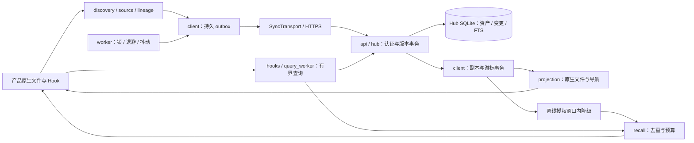

# 组织原生记忆架构与扩展约束

本设计以已实现的模块为基线。当前是**单节点 Hub、端侧可降级和恢复**，尚未实现跨机器自动故障切换，不宣称多节点高可用已经交付。四端实机验收状态见 [使用说明](README.zh.md)。

## 数据流与责任边界



Hook 负责事件和有界召回；worker 负责网络同步。产品继续生成记忆。新链路不调用旧 AMH 的提炼、治理、旧脑池写入或旧召回；规则和技能共享后仍须显式激活。检索结果是来源资料，不成为高优先级执行指令。

## 工程目录

```text
agent_brain/native_sync/      # 独立业务包；模块职责表见包内 README.md
  contracts.py               # SyncTransport：设备同步实际需要的接口和错误语义
  storage.py                 # SQLite 连接生命周期、Hub / Client 各自 schema
  common.py                  # 原子文件写入、hash、分词、运行时启动等基础函数
  hub.py / api.py / models.py # 服务端权威、HTTP 外观、输入校验
  client.py / worker.py      # 持久同步状态机与独立调度
  discovery.py / source.py   # 来源发现、历史边界、稳定读取、分块
  cowork_runtime.py          # 一次性配对、身份绑定、便携运行时入口
  runtime_sources.py         # 持久事件队列、后台基线、挂载身份与来源隔离
  lineage.py                 # 可观测消费证据和归属，不推断语义原创
  hooks.py / query_worker.py # Hook 生命周期与可终止的网络进程
  recall.py / projection.py # 上下文组装与原生可读资源
  materialize.py / assets.py # 完整资产导出、显式行为激活
  install.py / cli.py        # 安装、回执恢复、产品发现和命令装配
tests/native_sync/           # 协议、安装、业务边界、故障恢复、架构约束
docs/native-memory/          # 使用、架构、运维；不把内部进度混进产品说明
deploy/native-memory/        # systemd / Nginx 部署模板
```

当前模块规模适合单包职责划分；不为目录层数引入转发文件。数据库定义从业务编排中集中抽出，保持表名、列顺序和数据语义兼容。现有初始化 SQL 不是迁移工具；新增不兼容 schema 时必须实现版本迁移、旧库升级和恢复测试。

## 必须保持的不变量

| 边界 | 约束与原因 |
|---|---|
| 成员与组织 | 服务端凭设备凭证确定 tenant、member；请求不能指定生产者身份。默认组织内全项目可检索，project hint 只影响排序 |
| 历史 | 未选择旧文件及观察到的旧版本继续排除；重命名、复制、后续改写不能绕过选择 |
| 来源 | 原生产者与上传者分开；未知历史标未知。相同正文保留所有来源；没有完整消费证据不自动归为副本 |
| 服务器事务 | 同一事务更新当前资产、追加变更和 FTS；`BEGIN IMMEDIATE` 覆盖版本/身份检查与写入 |
| 幂等 | 内容一致的重放先于 base revision 冲突判断；成功响应丢失不会重复生成版本 |
| 本地事务 | 源版本与待传记录持久保存；下载页与游标同一次提交，进程退出不能跳过未应用的页 |
| 网络边界 | 不在数据库事务中等待网络。网络故障停止本批，记录级冲突保留待传并允许其他记录继续 |
| 原生投放 | 完整性/hash 校验后应用；不完整文档保留上一完整投放，其他文档仍可更新。修改/删除前比对拥有权，不覆盖用户编辑 |
| 授权 | 在线拒绝触发受管理副本清理；Hook 离线回退限最近成功授权后15分钟。此期限不等于已经投放到原生文件中的内容自动失效 |

`SyncTransport` 使用结构化类型契约约束 HTTP 实现和测试直连实现。产品适配不得绕开这条身份/版本链路。JSON 字段由服务端 `models.py` 校验，便携客户端不因此依赖 FastAPI/Pydantic。

Cowork 配对票据只允许当前认证成员登记另一个设备，不接受请求指定成员或组织。票据单次使用；默认15分钟，Cowork安装请求最多7天的独立配对票据，领取时再检查发起设备是否撤销。插件只固定公开的 Hub/成员信息，秘密连接文件独立存放；运行时凭证通过校验后才持久保存。新增 `runtime_invites` 表为兼容性增量，不更改既有成员/设备/资产表。

运行时的路径和身份检查不能只在发现阶段执行：文件系统可能在发现后、扫描前发生重新挂载。当前绑定记录目录的设备号/inode，并在扫描前后及发送前核验，同时检查最新 Hook 报告的项目身份；冲突来源保持隔离，其历史选择与队列保留供复核。Hook 不执行整库历史扫描，首次创建事件在配对前也进入持久队列。

## 当前可用性与故障隔离

- 上传至少一次尝试，Hub 幂等提交；outbox 按资产合并为最新待传状态，不承诺保留每次尚未上传的中间编辑。
- worker 有进程锁和指数退避，失败等待加入抖动，上限60秒；Hook 持续唤醒不能绕过失败冷却。重启后队列/游标从磁盘恢复。
- 网络或权限错误立即中止本批；记录冲突留待重试/诊断。`PermissionError` 不能当作普通断网继续消费缓存。
- 召回网络进程有650ms预算，数据库等待单次上限40ms；这些不是整个 Hook 总执行时间或全局 SLA。超时退回缓存/空结果，不阻断产品任务。
- `/health` 只报告进程协议；`/ready` 检查数据库存在、关键表/索引可访问及写锁可获得。锁等待上限100ms，不做全库完整性扫描，也不证明磁盘还有容量。
- systemd/LaunchAgent 模板支持进程重新启动；真实部署状态须单独验收。备份通过 SQLite backup API，恢复须验证内容和撤销状态。

单机磁盘损坏、主机断电、证书过期仍可能阻断实时云端同步。当前没有数据库复制、选主、自动切流或已证明的生产 RPO/RTO，不能把重启策略写成跨主机高可用。

## 多节点高可用的演进设计

保持 `/native/v1` 和来源/版本契约稳定，服务端可以替换持久层实现，但**不能**把两个独立 SQLite 文件直接置于负载均衡后，也不能让多台主机共享网络盘上的 WAL 文件。

进入多节点实现前，需要将 Hub 的身份、资产版本、变更序列和检索更新置于具有一致事务保证的共享持久层；身份撤销不能依赖落后的只读副本。若检索改为异步外部索引，必须增加事务 outbox、可见版本水位与删除传播验证，不能只返回“已保存”便假定“已可检索”。

应用实例按就绪状态接流量；备份、主节点失效隔离、恢复后撤销对账与切流需成为独立演练。验收须覆盖：写入成功后断连重放、切换时并发写入、延迟副本上的撤销与删除、游标不跳页、索引重建。RPO/RTO 根据组织可接受的损失/停机窗口设定并实测；本轮未实现或承诺该阶段。

## 扩展新产品或能力

1. **新产品**：先验证其真实 Hook 输入、执行环境、原生存储和读取时机；在 `install/discovery` 接入发现与安装，在 `source/projection/lineage` 接入文件和消费证据。只添加产品名称不代表完成适配。
2. **新传输方式**：实现 `SyncTransport` 的四项设备操作，维持身份绑定、幂等和错误分类。禁止在传输内部叠加隐藏重试；Hook 和后台调度的预算不同。
3. **新资产类型**：补齐输入模型、稳定读取/分块、完整性校验、检索资格及显式生效方式；不要将任意下载文件直接当作可执行规则。
4. **新检索实现**：保留默认组织范围、显式项目过滤、生产者/版本和删除过滤；模型改写去重必须另有可核验规则，不能静默丢来源。
5. **新运行时依赖**：检查 Cowork 导出清单。架构测试验证便携运行包的依赖闭合且仅使用标准库；安装/服务端依赖不进入运行包。

每项扩展至少通过自身回归与受影响的历史选择、身份、防回流、原生读取测试；真实产品测试与协议测试分开报告。
